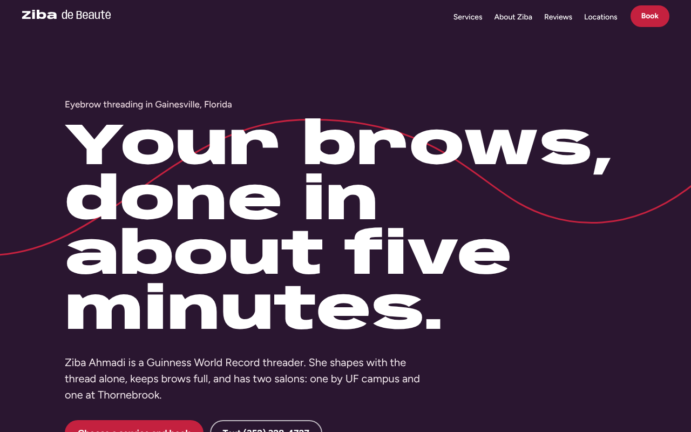
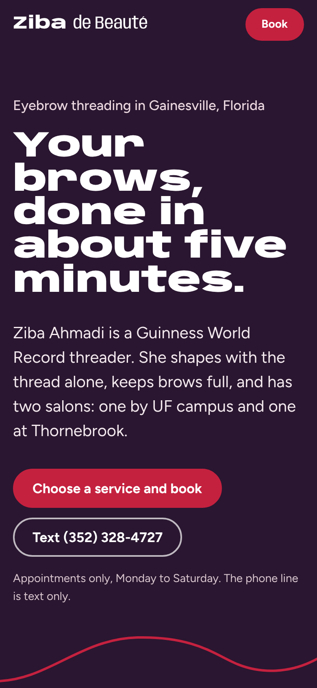
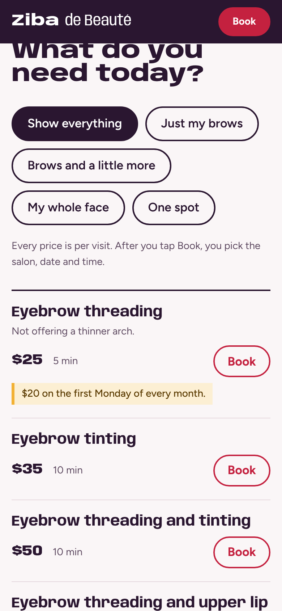

# Ziba de Beauté: salon website redesign

**Live site:** https://zibadebeaute.pages.dev/
**Case study:** https://zibadebeaute.pages.dev/case-study.html

A redesign of [zibadebeaute.com](https://zibadebeaute.com) for Ziba Ahmadi, a Guinness World Record eyebrow threader with two salons in Gainesville, FL. Client work by Propolis Freelancing.



## Results

Measured with Google PageSpeed Insights (Lighthouse 13.5.0) on both sites, one minute apart, on October 13, 2026. The new site is the Astro build on Cloudflare Pages.

| | Old, mobile | New, mobile | Old, desktop | New, desktop |
|---|---:|---:|---:|---:|
| Performance | 56 | **100** | 83 | **100** |
| Accessibility | 78 | **100** | 90 | **100** |
| Best practices | 96 | **100** | 96 | **100** |
| SEO | 85 | **100** | 92 | **100** |
| Largest contentful paint | 10.7 s | **1.2 s** | 1.9 s | **0.3 s** |
| Page weight | 2,852 KiB | **93 KiB** | 2,708 KiB | **369 KiB** |

PageSpeed varies run to run (across three runs on October 12–13 the old site scored 44–56 on mobile performance; the table uses its best). [All runs are recorded](public/metrics/psi.json) with links to the full reports.

Other measured changes on the home page:

- Scripts: 57 → 1. Stylesheets: 45 → 1.
- Photos with descriptive alt text: 0 of 4 → 5 of 5.
- Structured data for Google: none for the business → a `BeautySalon` entry for each location.
- Visible typos: 4 → 0. Leftover template content ("Hello world!" post and others): 4 items → 0.

The [case study](https://zibadebeaute.pages.dev/case-study.html) has the full before-and-after list.

## What I built

- **One page instead of five.** All 14 services with prices and times, a "What do you need today?" filter, both locations, press, reviews and contact info. Each service links straight to its booking page.
- **A booking page.** Each Book button opens `book.html` with that service selected. Clients pick a salon, a day and time of day, and their name. The page writes the text to Ziba (prefilled `sms:` link, plus a copy button for desktop) and links to her current calendar. It catches Sundays and applies deal-day prices.
- **Deal days that show real dates.** The old site said "first Monday of each month". The new one works out the next date in the salon's time zone and highlights the deal on the day.
- **Accurate content.** Fixed the search description, which listed three services she doesn't offer. The text-only number now opens a text message instead of a call. Both locations are listed. Each press mention links to the article.
- **Mobile first.** A sticky booking button appears once you scroll past the hero. Every button is at least 44 px tall, and nothing scrolls sideways at widths from 320 px up.

<p>
  
  
</p>

## Technical decisions

- **Astro, static output, on Cloudflare Pages.** Pages are Astro templates and components (`src/`); the browser gets plain HTML, CSS and a little vanilla JavaScript (no client-side framework). The page works with JavaScript off; scripts only add the filter, the deal dates and the review ticker.
- **Self-hosted fonts with metric-matched fallbacks.** Removing the Google Fonts request chain took mobile performance from 91 to 99. The fallback fonts are sized from the real fonts' measurements (computed with fontTools), so the headline does not move when the fonts load: layout shift went from 0.061 to 0.
- **Images.** Converted to WebP and resized to their largest display size: 544 KB → 249 KB. Each has its width and height set, so nothing shifts while it loads.
- **Lazy third parties.** The YouTube documentary loads only when someone presses play.
- **Accessibility.** Skip link, visible focus, `aria-pressed` filter buttons, screen-reader labels on every Book link, and reduced-motion support for the thread animation and the review ticker.

## How Ziba edits the site

Prices, services, monthly deal days, hours, the online booking link and gallery photos live in `content/*.json`. Ziba edits them in [Pages CMS](https://pagescms.org) through simple forms (configured in `.pages.yml`), with no code. Every save:

1. commits to this repo,
2. triggers a Cloudflare Pages build (`npm run build`), where `src/lib/content.js` validates the content and Astro builds the pages and converts uploaded photos to WebP,
3. publishes to zibadebeaute.pages.dev in about a minute.

If an edit has a problem (an empty price, or a deal price above the regular price), the build stops with a plain-English list and the live site stays as it was. The Gallery page and menu link appear only once there is at least one photo.

## Run locally

```sh
npm install
npm run dev            # local preview at http://localhost:4321
npm run build          # writes the site to dist/
```

To re-measure: `NEW_URL=https://zibadebeaute.pages.dev/ node scripts/measure.mjs` (writes `metrics/psi-latest.json`).

## Before launch at zibadebeaute.com

- **Online booking:** when Ziba is set up on Square Appointments, she pastes her booking link in Pages CMS → Settings. Until then, "See open times" uses her current WordPress calendar.
- **End-of-day unpaid-appointments text:** planned after the move to Square (needs her Square access key and a texting account such as Twilio).
- **Hours:** the site says "Monday to Saturday, by appointment only", as the old site does, but Google Maps lists both salons as open daily. To confirm with Ziba.
- The old GitHub Pages address (sonireddy55.github.io/ZibadeBeaute-) redirects every page to Cloudflare (`redirect/`, deployed by `.github/workflows/build.yml`).
- `canonical` and `og:url` point to `https://zibadebeaute.com/`, which is correct only once this site replaces the old one.
